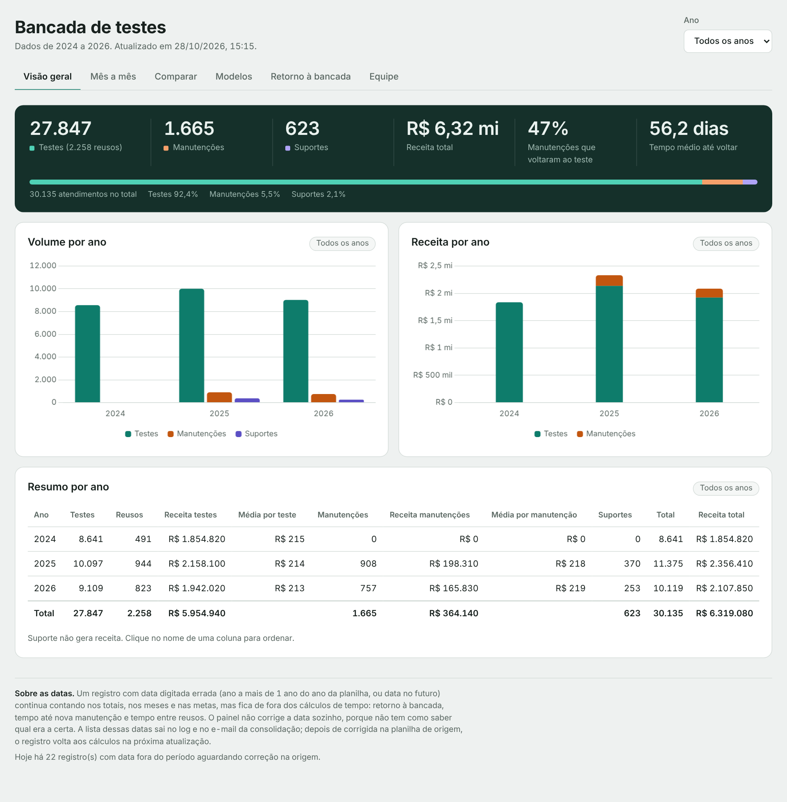
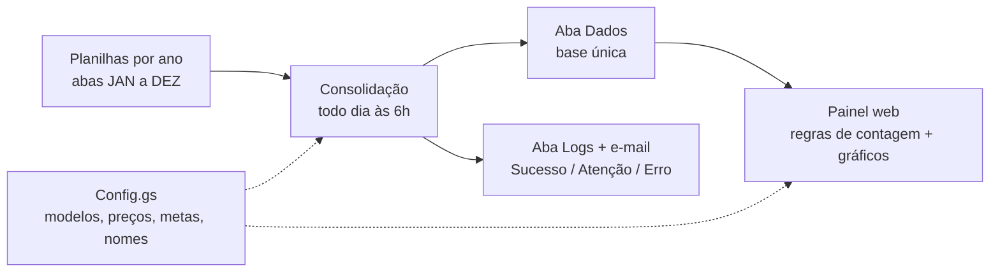
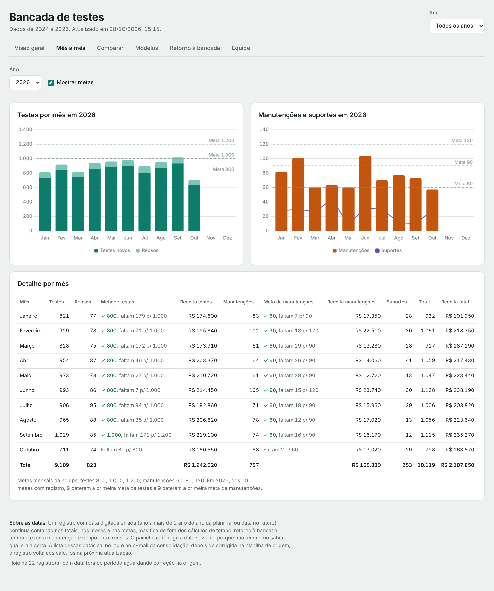
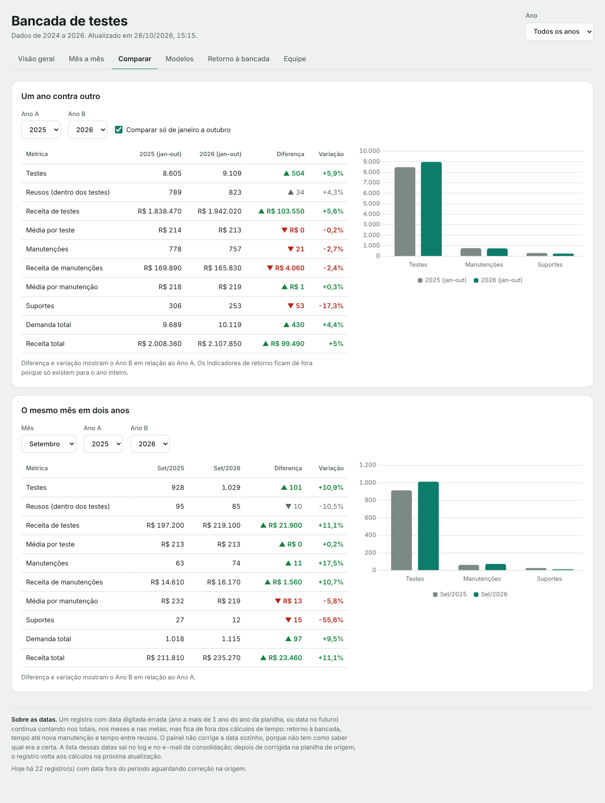
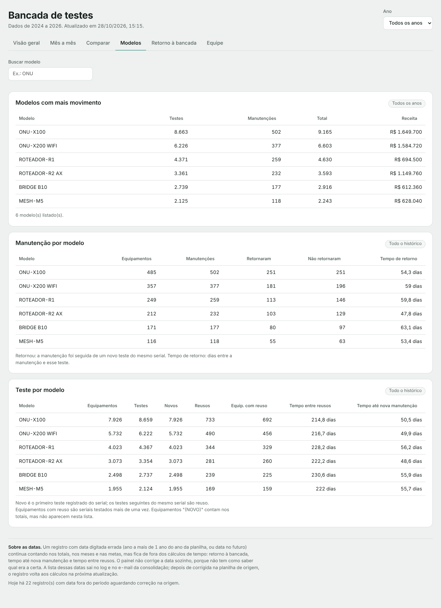
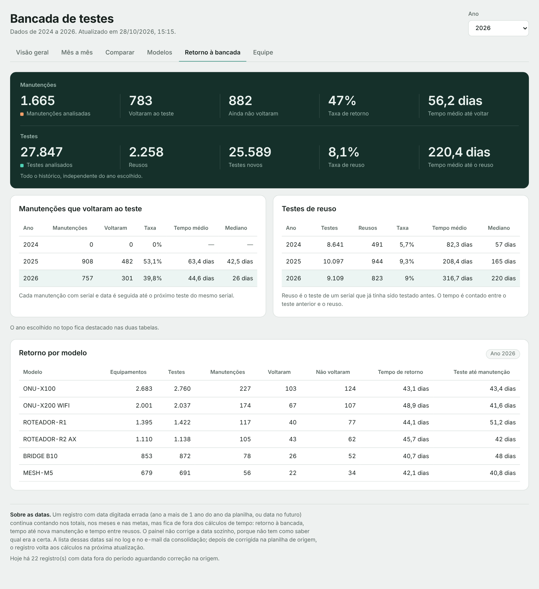
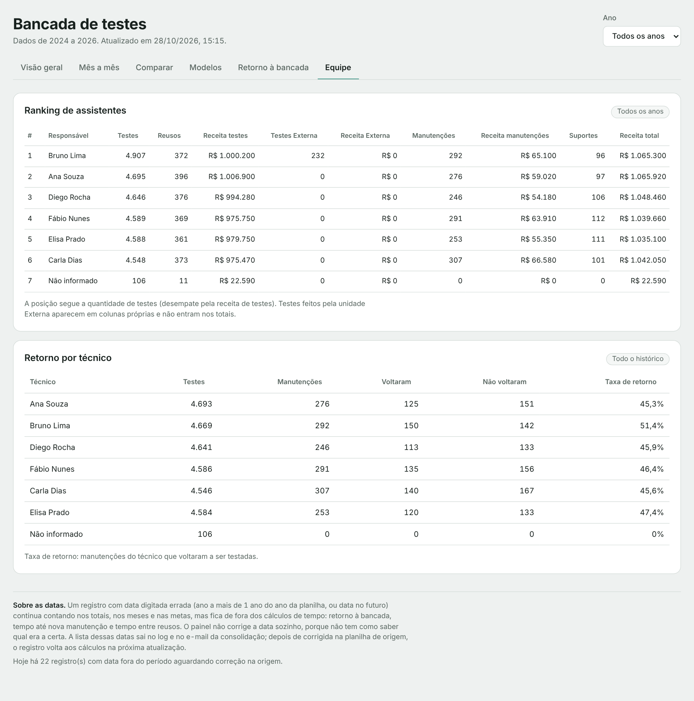
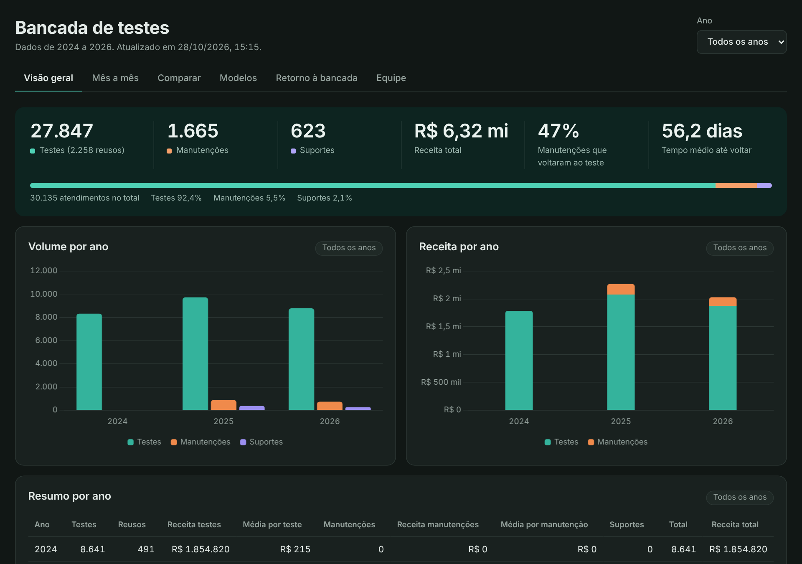
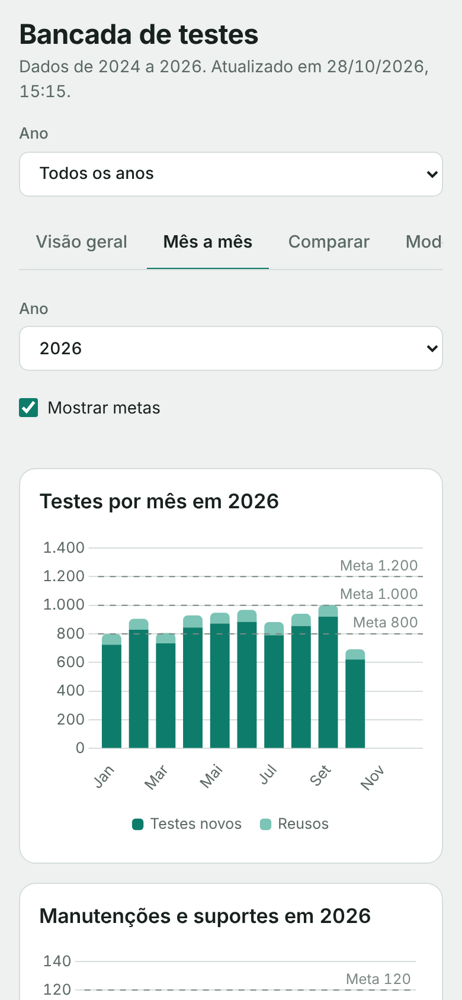

# Painel da Bancada de Testes

Painel web que consolida, todos os dias, as planilhas de uma bancada de testes de equipamentos de rede (testes, manutenções e suportes) e mostra metas mensais, receita, retorno de equipamentos e desempenho da equipe.

Construído com **Google Apps Script**, **Google Sheets** e **Chart.js**.

> **Todos os dados deste repositório são fictícios.** Modelos, preços, pessoas e metas foram inventados. O projeto original roda numa operação real de telecom; esta é uma versão pública, com a configuração da operação separada do código e substituída por valores de exemplo.

## O problema

Os registros da bancada ficavam espalhados em uma planilha por ano, com uma aba por mês. O formato das abas mudou ao longo do tempo: um ano tinha só testes, com colunas parecidas ("Responsável", "Responsável p/ Limpeza", "Responsável p/ Embalagem"); nos anos seguintes, testes, manutenções e suportes passaram a ficar em blocos lado a lado. O mesmo modelo aparecia escrito de várias formas, uma parte dos registros não tinha receita e havia datas digitadas com o ano errado.

Responder perguntas simples, como "batemos a meta de testes este mês?" ou "quanto tempo um equipamento leva para voltar depois da manutenção?", exigia abrir várias planilhas e contar à mão.

## O que foi construído

- **Consolidação diária (ETL):** um script lê as abas de mês de todas as planilhas ativas, reconhece os dois formatos de aba, padroniza nomes, completa a receita vazia pela tabela de preços e grava uma base única (aba Dados).
- **Regras de negócio definidas com a operação:** o que conta na meta, o que é reuso, o que fica de fora (ferramentas, modelo vazio, testes de outra unidade).
- **Painel web** com seis abas: visão geral, mês a mês com metas, comparação entre anos, modelos, retorno à bancada e equipe.
- **Qualidade de dados:** datas impossíveis são sinalizadas e ficam fora dos cálculos de tempo; tabelas de resumo dentro das abas são descartadas; a base não é apagada se a leitura falhar.
- **Monitoramento:** cada execução grava uma linha na aba Logs e envia um e-mail com status (Sucesso, Atenção ou Erro). Uma queda de 20% ou mais no volume vira alerta.
- **Documentação das métricas** para a supervisão: [docs/indicadores.md](docs/indicadores.md).

## Arquitetura

| Arquivo | Papel |
| --- | --- |
| `Consolidacao.gs` | Lê as planilhas de origem, detecta cabeçalhos e blocos, padroniza e grava a aba Dados |
| `Webapp.gs` | Backend do web app: aplica as regras de contagem e calcula os agregados |
| `Index.html` | Interface: abas, gráficos (Chart.js), tabelas ordenáveis, tema claro e escuro |
| `Logs.gs` | Executa a consolidação diária, grava a aba Logs e envia o e-mail |
| `DiagnosticoResponsavel.gs` | Diagnóstico de registros sem responsável, por ano e mês |
| `Config.exemplo.gs` | Configuração fictícia: modelos, preços, metas, nomes |
| `Demo.gs` | Gera dados fictícios e roda a consolidação real sobre eles |

A configuração da operação fica num único arquivo. No ambiente real ele se chama `Config.gs` e não é versionado (está no `.gitignore`); aqui ele é substituído pelo `Config.exemplo.gs`.

## Regras de negócio

| Registro | Conta nos totais e metas? | Observação |
| --- | --- | --- |
| Teste de equipamento | Sim | Regra geral |
| Reuso (serial já testado antes) | Sim | Aparece separado como informação |
| Equipamento "(NOVO)" | Sim | Fica fora das tabelas por modelo |
| Suporte | Sim | Apoio a outros setores; não depende de modelo |
| Teste com modelo vazio | Não | |
| Ferramentas (clivador, power meter…) | Não | Configurável (`CONTAR_FERRAMENTAS`) |
| Testes de outra unidade | Não | Aparecem só no ranking, em colunas próprias |

**Reuso:** para cada serial, os testes são ordenados por data; o primeiro é novo e os seguintes são reuso.
**Retorno de manutenção:** a manutenção é seguida até o próximo teste do mesmo serial, no mesmo dia ou depois.

## Problemas de dados encontrados e tratados

| Problema | Efeito antes | Tratamento |
| --- | --- | --- |
| Colunas com nomes parecidos ("Responsável" x "Responsável p/ Embalagem") | O script lia a coluna errada e boa parte de um ano ficava sem responsável | O nome exato tem prioridade; entre parecidos, vale o primeiro |
| Suportes sem modelo | Todos os suportes eram descartados pelo filtro de modelos | Suporte não passa pelo filtro |
| Tabela de resumo dentro da aba do mês | Nomes de pessoas apareciam como modelos | Linhas sem data e sem responsável são descartadas |
| Datas com ano errado (ex.: ano 2056) | Tempos médios de milhares de dias | Datas fora do período ficam fora dos cálculos de tempo e vão para o log |
| Mesmo modelo escrito de várias formas | Um modelo espalhado em várias linhas | Mapa de grafias no `Config.gs` |
| Receita não registrada em um ano | Receita zerada | Preenchida pela tabela de preços, com aviso para modelo sem preço |

## Como rodar a demonstração

1. Crie uma planilha no Google Sheets e abra **Extensões > Apps Script**.
2. Crie os arquivos da pasta `src/` com os mesmos nomes e cole o conteúdo. Use **só** o `Config.exemplo.gs` (não crie um `Config.gs`).
3. Rode `gerarDadosDemo()` (arquivo `Demo.gs`) e autorize o acesso à planilha. A aba Dados é criada com cerca de 31 mil registros fictícios.
4. **Implantar > Nova implantação > App da Web** e abra o link.

Para testar o fluxo completo, rode `gerarPlanilhasOrigemDemo()`. Ele cria uma planilha por ano no seu Drive, com as abas de mês nos dois formatos, e preenche a aba Config. Depois rode `executarConsolidacaoDiaria()` para consolidar, gravar o log e receber o e-mail.

As funções do `Demo.gs` só rodam com `MODO_DEMO = true`, que existe apenas no `Config.exemplo.gs`.

Com o [clasp](https://github.com/google/clasp) dá para enviar a pasta `src/` direto para o projeto (`"rootDir": "src"` no `.clasp.json`).

## Dados fictícios para análise

[`dados-exemplo/dados_ficticios.csv`](dados-exemplo/dados_ficticios.csv) é a aba Dados gerada pela demonstração (31.092 linhas, 2024 a 2026), no ponto em que sai da consolidação: nomes de responsáveis ainda sem padronizar e com os erros de digitação propositais. Datas no formato `AAAA-MM-DD` e receita com ponto decimal. Serve para refazer as análises em SQL, Python ou Power BI.

## Telas

| | |
| --- | --- |
|  |  |
|  |  |
|  |  |

## Tecnologias

Google Apps Script (JavaScript V8) · Google Sheets · HtmlService · Chart.js 4 · MailApp
